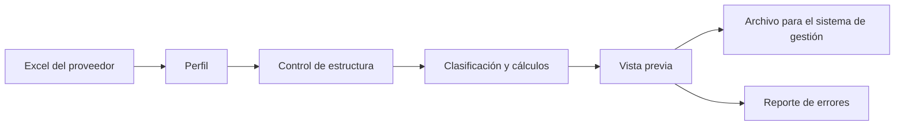
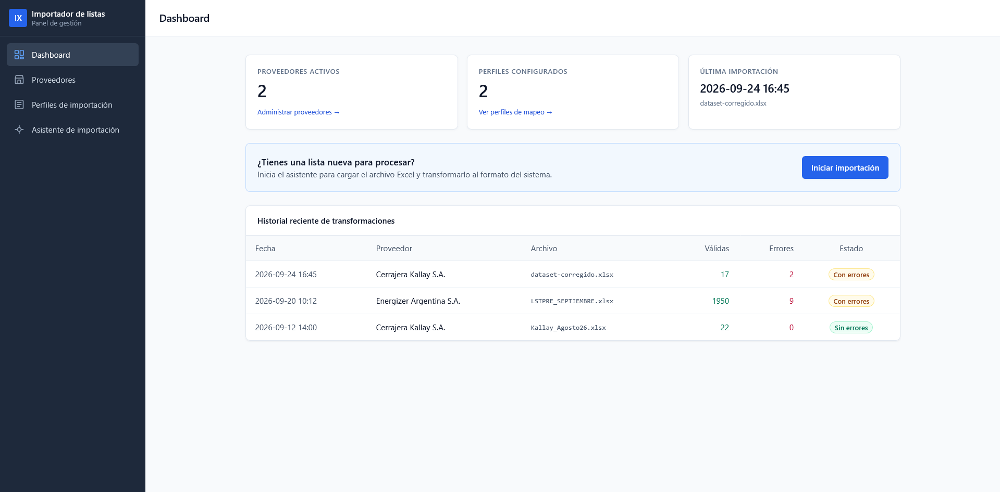

# Organizalo

Importador de listas de precios de proveedores. Trabajo Integrador Final de la Tecnicatura Universitaria en Programación a Distancia (UTN), 2026, grupo 174.

## Entrega final

| Recurso | Enlace |
| --- | --- |
| Sistema desplegado (API) | https://tpifinaldesideriovazquez-production.up.railway.app/api/salud |
| Frontend desplegado | _pendiente_. Mientras tanto se corre en local (ver [Frontend](#frontend)) |
| Informe Final (PDF) | [docs/informe-final.pdf](docs/informe-final.pdf) |
| Video de presentación | _pendiente_ |
| Versión entregada | tag `v1.0` |

**Cuenta de demostración:** `operador@tpi.local` / `operador123`, o `admin@tpi.local` / `admin123` para administrar proveedores. Son los usuarios de prueba de `seed.sql`, no credenciales reales.

## Integrantes

- Franco Gabriel Vazquez

Lucas Desiderio participó en la 1.ª y la 2.ª entrega y después dejó el proyecto; por eso el repositorio lleva su apellido.

## Problema

Los pequeños negocios reciben listas de precios en Excel de varios proveedores. Cada lista tiene un formato distinto, y hoy se pasan a mano al formato fijo que acepta su sistema de gestión: eso lleva entre 2 y 3 horas por semana y genera errores en precios y códigos.

## Solución

Organizalo importa la lista del proveedor, la transforma según un **perfil** configurado una vez por cada hoja de cada proveedor y exporta un archivo listo para el importador de productos del sistema de gestión del negocio.

El perfil indica qué hoja leer, en qué fila están los encabezados, qué representa cada columna y qué cálculos aplicar (IIBB, ganancia, IVA). Si el archivo ya no cumple el perfil, se informa qué cambió. Las filas con errores se informan, no se descartan en silencio.



## Demo del Frontend



## Tecnologías

| Capa | Tecnología |
| --- | --- |
| Frontend | React + Tailwind (Railway) |
| Backend | Java 17 + Spring Boot 4 (Web, JDBC, Security) + Apache POI (Railway, Docker) |
| Base de datos | PostgreSQL (Railway) |
| Pruebas | JUnit 5 + AssertJ + MockMvc, con PostgreSQL embebido |

## Limitaciones

- Ferretería y Paint Roller usan una regla provisoria (`precio = costo`) hasta confirmar sus porcentajes con el negocio.
- Solo se aceptan listas en pesos. Una hoja en dólares se rechaza por encabezado modificado.
- Los perfiles se cargan en la base (`seed.sql`). La interfaz los muestra, pero no los edita.
- No se implementó la importación de archivos que ya vienen en el formato destino, ni la purga de importaciones vencidas (`expira_en` solo marca la fecha).
- Fuera del alcance: stock, ventas, multitenancy y conversión de monedas o unidades.
- La API corre en el plan gratuito de Railway.

## Documentación

- [Informe Final (PDF)](docs/informe-final.pdf)
- [Base de datos](docs/base-de-datos.md)
- [Módulos](docs/modulos.md)
- [Entregas y devoluciones](docs/entregas.md)

## Estructura

```
├── backend/           API REST y motor de transformación (Spring Boot)
├── database/          scripts SQL (schema.sql, seed.sql)
├── dataset-example/   Excels reales de proveedores y de la plataforma anterior
├── frontend/          frontend React + Tailwind (Vite), conectado a la API
├── docs/              documentación
├── docker-compose.yml PostgreSQL + backend en local
├── railway.json       despliegue de la API en Railway
└── render.yaml        despliegue alternativo en Render
```

## Instalación

### Base de datos

Crear una base vacía en PostgreSQL:

```bash
createdb tpi_final
```

Al arrancar, el backend ejecuta `database/schema.sql` y `seed.sql` si la base no tiene tablas. La conexión se configura con `DB_HOST`, `DB_PORT`, `DB_NAME`, `DB_USER` y `DB_PASSWORD` (por defecto `localhost:5432/tpi_final`, usuario y clave `postgres`).

### Backend (requiere Java 17)

```bash
cd backend
./mvnw test             # pruebas (levantan un PostgreSQL embebido, no hace falta tenerlo instalado)
./mvnw spring-boot:run  # API en http://localhost:8080
```

La API usa HTTP Basic (header `Authorization` en cada pedido). Usuarios de prueba del `seed.sql`:

| Email | Contraseña | Rol |
| --- | --- | --- |
| `admin@tpi.local` | `admin123` | `ADMIN`: además administra proveedores |
| `operador@tpi.local` | `operador123` | `OPERADOR`: importa y exporta |

| Método | Ruta | Qué hace |
| --- | --- | --- |
| `GET` | `/api/salud` | Estado del servicio (sin login) |
| `GET` | `/api/auth/yo` | Usuario autenticado; el frontend lo usa para validar el login |
| `GET` | `/api/proveedores` | Proveedores con su cantidad de perfiles |
| `POST` / `PUT` | `/api/proveedores`, `/api/proveedores/{id}` | Alta y edición (solo `ADMIN`): `{ "nombre": "...", "activo": true }` |
| `DELETE` | `/api/proveedores/{id}` | Baja de un proveedor sin perfiles (si tiene, se desactiva) |
| `GET` | `/api/perfiles` | Lista los perfiles |
| `GET` | `/api/perfiles/{id}` | Perfil completo: columnas, transformaciones y reglas |
| `POST` | `/api/importaciones/preview` | Vista previa: procesa y guarda la importación. Multipart con `perfil` (id, por ejemplo `1` = Ferretería LSTPRE) y `archivo` |
| `GET` | `/api/importaciones` | Historial, las más nuevas primero |
| `GET` | `/api/importaciones/{id}` | Importación completa: diferencias, resumen y filas |
| `POST` | `/api/importaciones/{id}/confirmar` | Confirma una vista previa (409 si no está en `PREVIEW` o no tiene filas válidas) |
| `POST` | `/api/importaciones/{id}/cancelar` | Descarta una vista previa |
| `GET` | `/api/importaciones/{id}/exportar` | XLSX para el importador del sistema de gestión: filas válidas, columnas del formato destino, precios con 2 decimales. Solo de una importación confirmada |
| `GET` | `/api/importaciones/{id}/errores` | XLSX con las filas rechazadas (motivo y datos originales) y los avisos: diferencias de estructura y códigos repetidos |

Los perfiles se leen de la base (los cinco de `seed.sql`).

### Pruebas

```bash
cd backend
./mvnw test
```

Incluyen pruebas unitarias del motor, pruebas de referencia contra los Excel de `dataset-example/` y pruebas de la API. La comparación con la corrección manual de Paint Roller usa archivos del cliente que no están en el repo: se corre definiendo `DATASET_EXTERNO` con la carpeta que los contiene; si no está, se saltea.

### Frontend

Con el backend corriendo:

```bash
cd frontend
npm install
npm run dev
```

Abrí `http://localhost:5173` e ingresá con uno de los usuarios de prueba. Todas las pantallas usan la API. Para otra URL del backend, copiá `.env.example` a `.env` y cambiá `VITE_API_URL`.

### Con Docker

Levanta PostgreSQL y el backend juntos, sin instalar Java ni PostgreSQL:

```bash
docker compose up --build   # API en http://localhost:8080
```

El frontend se corre igual que arriba.

## Despliegue en Railway

`railway.json` hace que Railway construya la API con `backend/Dockerfile` (desde la raíz del repo, porque el jar incluye `database/*.sql`) y revise `/api/salud` para saber si arrancó.

1. **Base de datos:** en el proyecto de Railway, **+ Create → Database → PostgreSQL**.
2. **API:** **+ Create → GitHub Repo** con este repositorio, con *Root Directory* `/`. En **Variables**:
   ```
   DB_HOST=${{Postgres.PGHOST}}
   DB_PORT=${{Postgres.PGPORT}}
   DB_NAME=${{Postgres.PGDATABASE}}
   DB_USER=${{Postgres.PGUSER}}
   DB_PASSWORD=${{Postgres.PGPASSWORD}}
   CORS_ORIGENES=https://<dominio-del-frontend>
   ```
   El puerto no se configura: Railway define `PORT` y la API lo usa. En **Settings → Networking → Generate Domain** se obtiene la URL pública.
3. La base se crea vacía: en el primer arranque la API ejecuta `schema.sql` y `seed.sql`.
4. **Frontend:** ver la sección siguiente.

### Frontend en Railway

`frontend/railway.json` hace que Railway construya el sitio con Vite (`npm run build`) y lo sirva como estático.

1. En el mismo proyecto: **+ Create → GitHub Repository** y elegir este repositorio.
2. En el servicio nuevo, **Settings**:
   - *Root Directory*: `frontend`
   - *Config File Path*: `/frontend/railway.json`. Si no se define, toma el `railway.json` de la raíz, que es el de la API, y el build falla.
3. En **Variables**: `VITE_API_URL=https://<dominio-de-la-api>`, sin barra final. Se usa al construir el sitio: si se cambia, hay que volver a desplegar.
4. **Settings → Networking → Generate Domain** para obtener la URL del frontend.
5. En el servicio de la API, poner esa URL en `CORS_ORIGENES` (sin barra final). La API se vuelve a desplegar sola.
6. Abrir la URL del frontend e ingresar con la cuenta de demostración. Si el login falla con un error de red, revisar `CORS_ORIGENES` y `VITE_API_URL`.

Si la API termina con `Connection refused`, faltan las variables `DB_*` o el servicio de PostgreSQL no se llama `Postgres` (el nombre tiene que coincidir con el de las referencias `${{...}}`).

`render.yaml` queda como alternativa para desplegar en Render (**New → Blueprint**).
