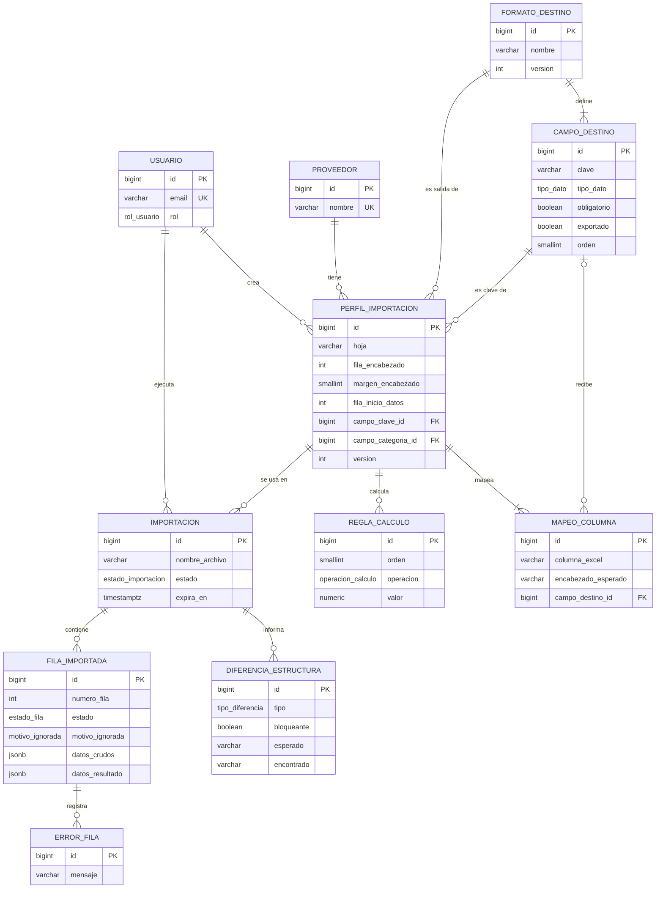

# Base de datos

[← README](../README.md)

**Motor:** PostgreSQL. Script: [`database/schema.sql`](../database/schema.sql) · Datos de ejemplo: [`database/seed.sql`](../database/seed.sql)

## Por qué PostgreSQL

Los datos del sistema (usuarios, proveedores, perfiles, importaciones, errores) tienen estructura fija y están relacionados entre sí. Lo único que cambia según el proveedor es la fila original del Excel, y eso se guarda en una columna `JSONB`. Por eso alcanza con una sola base relacional.

## Diagrama

## Tablas

| Tabla | Qué guarda |
| --- | --- |
| `usuario` | Usuarios del sistema (admin u operador) |
| `proveedor` | Proveedores que envían listas: nombre y si está activo |
| `formato_destino` / `campo_destino` | Formato que acepta el sistema destino y sus columnas |
| `perfil_importacion` | Contrato de **una hoja**: hoja, fila de encabezados, fila de inicio, campo clave y campo de categoría |
| `mapeo_columna` | Columna del Excel → campo destino (o ignorada), encabezado esperado y transformaciones |
| `regla_calculo` | Cálculos en orden (IIBB, ganancia, IVA…) |
| `importacion` | Historial: qué archivo, quién, cuándo, resultado |
| `diferencia_estructura` | Qué no coincide entre el archivo y el perfil |
| `fila_importada` | Cada fila leída, original y transformada, con su estado |
| `error_fila` | Motivo de rechazo de una fila |

## Formatos destino

| Formato | Uso |
| --- | --- |
| `organizalo` | Sistema destino: el importador de productos de Organizalo (Codigo, Nombre, Descripcion, Categoria, Stock, Precio, Ingresos brutos, Ganancia, IVA, Precio + IVA). `precio_costo` es auxiliar: se usa en los cálculos y no se exporta |
| `plataforma_anterior` | Planilla que se completaba a mano. Se usa como referencia para comprobar los cálculos |

## Decisiones

- **Un perfil, una hoja.** Un proveedor puede tener varios perfiles si su workbook trae varias listas (por ejemplo, `LISTAS CUENTA 2` tiene siete hojas con estructuras distintas).
- **Porcentajes como fracción:** `0.04` = 4 %, igual en la base, la API, el motor y el frontend. La interfaz puede mostrar "4 %", pero guarda y envía `0.04`. El formato `organizalo` no exporta columnas de porcentaje, así esa conversión no se mezcla con el modelo.
- **Reglas por proveedor:** los porcentajes de un proveedor no se copian a otro. Ferretería y Paint Roller tienen una regla provisoria y explícita (`precio = costo`) hasta confirmar sus porcentajes con el negocio.
- **Cambio de formato:** cada `encabezado_esperado` se compara con el archivo. Cada diferencia queda en `diferencia_estructura` con su tipo (ver [Módulos](modulos.md#control-de-estructura)). Si hay alguna bloqueante, la importación queda `RECHAZADA` y no se procesa ninguna fila.
- **Encabezado desplazado:** `margen_encabezado` acepta los mismos encabezados unas filas más arriba o más abajo (LSTPRE los trae en la fila 7 o en la 8 según la versión). Se informa como aviso y `fila_inicio_datos` se corre lo mismo.
- **Stock opcional:** si el proveedor no lo informa, queda vacío. Si viene un valor que no es entero (`10KG`), la fila es un error.
- **Proveedor mínimo:** solo nombre y estado. Los datos de contacto ya están en el sistema destino.
- **Moneda:** solo se aceptan listas en pesos. Ver [Módulos](modulos.md#listas-en-dólares).
- **Versiones de perfil:** si el proveedor cambia su lista, se crea una versión nueva y el historial viejo no se toca.
- **Tiempo de guardado:** `expira_en` (90 días) indica desde cuándo una importación **se puede** purgar. Guardar la fecha no borra nada: hace falta una tarea de limpieza, que todavía no existe.
- **Cálculos acotados:** solo las operaciones del tipo `operacion_calculo`, sin fórmulas libres.
