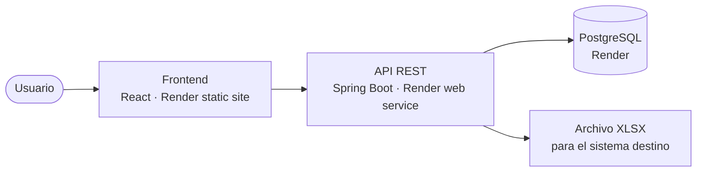
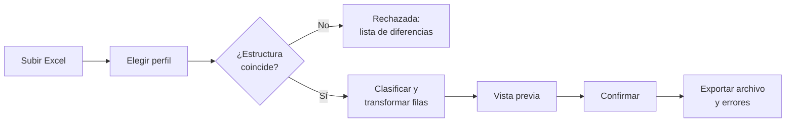

# Módulos

[← README](../README.md)

## Arquitectura

## Listado

| # | Módulo | Qué hace | Prioridad |
| --- | --- | --- | --- |
| 1 | Usuarios | Login e historial por usuario | MVP |
| 2 | Proveedores | Alta, edición y baja de proveedores | MVP |
| 3 | Formato destino | Columnas que acepta el sistema destino | MVP |
| 4 | Perfiles de importación | Hoja, filas, mapeo de columnas y cálculos por proveedor | MVP |
| 5 | Lectura de Excel | Lee hojas y filas del archivo (Apache POI) | MVP |
| 6 | Motor de transformación | Controla la estructura, clasifica filas, valida, transforma y calcula | MVP |
| 7 | Importaciones | Vista previa, confirmación e historial | MVP |
| 8 | Exportación | Archivo final y reporte de filas con error | MVP |
| 9 | Frontend | Pantallas para operar todo lo anterior | MVP |
| 10 | Plantilla conocida | Importar archivos que ya vienen en el formato destino | Opcional |

## Flujo principal

## Control de estructura

Antes de procesar filas, el motor compara el archivo con el perfil. Los encabezados se comparan sin distinguir mayúsculas, tildes ni espacios repetidos.

| Diferencia | Cuándo | ¿Bloquea? |
| --- | --- | --- |
| `HOJA_INEXISTENTE` | El archivo no tiene la hoja del perfil. Se informan las hojas que sí tiene | Sí |
| `ENCABEZADO_MODIFICADO` | La celda tiene otro texto (`PRECIO` → `PRECIO U$S`) | Sí |
| `COLUMNA_FALTANTE` | La celda del encabezado está vacía | Sí |
| `POSICION_INESPERADA` | El encabezado existe, pero en otra columna | Sí |
| `ENCABEZADO_DESPLAZADO` | Todos los encabezados están, pero unas filas más arriba o más abajo, dentro de `margen_encabezado` | No, es un aviso |

Las columnas ignoradas también se controlan: si cambian, la lista cambió y conviene revisar el perfil.

## Clasificación de filas

Desde `fila_inicio_datos` hasta la última fila, cada fila recibe un estado. Solo se miran las columnas mapeadas, y un `0` en un campo numérico cuenta como vacío (Fenix arrastra fórmulas que dan 0 en filas sin producto).

| Condición | Estado | Ejemplo real |
| --- | --- | --- |
| Ninguna columna mapeada tiene valor | `IGNORADA` (`VACIA`) | LSTPRE fila 8 |
| Sin campo clave y sin ningún número distinto de 0 | `IGNORADA` (`TITULO`). Si el perfil tiene `campo_categoria`, su texto se asigna a los productos siguientes | LSTPRE fila 10: `PILAS ENERGIZER ALCALINAS` |
| Tiene campo clave o algún número, pero falta el campo clave o un obligatorio, un valor no se puede convertir, un número obligatorio no es mayor a 0 o un cálculo falla | `ERROR`, con el motivo | Paint Roller: precio `SIN STOCK`; precio sin código. Fenix: código con precio 0 |
| Todo lo demás | `VALIDA` | LSTPRE fila 12: `EP52`, 1474.41 |

Una fila con error no lleva datos parciales al resultado: se informa y queda afuera del archivo final. Los códigos repetidos dentro de la misma lista (Paint Roller usa `RAPIFIX` 49 veces) se informan como aviso.

## Transformaciones

| Transformación | Qué hace |
| --- | --- |
| `TRIM` | Quita espacios al principio y al final |
| `MAYUSCULAS` | Pasa el texto a mayúsculas |
| `A_DECIMAL` / `A_ENTERO` | Acepta números escritos como texto (`1.474,41`). Sin ellas, un texto en un campo numérico es error |
| `RELLENAR_ABAJO` | Si la celda está vacía, usa el último valor de esa columna. Se reinicia en cada fila título. Sirve para nombres de grupo en celdas combinadas (Paint Roller) |

## Operaciones de cálculo

Conjunto cerrado. Los porcentajes son fracciones (`0.04` = 4 %).

| Operación | Resultado |
| --- | --- |
| `COPIAR` | base |
| `VALOR_FIJO` | valor |
| `SUMAR_PORCENTAJE` / `RESTAR_PORCENTAJE` | base × (1 ± valor) |
| `MULTIPLICAR` / `DIVIDIR` | base × valor, base ÷ valor |
| `SUMAR_CAMPO` | base + secundario |
| `CONCATENAR` | base y secundario unidos por un espacio, salteando los vacíos |

El motor no redondea: conserva la precisión completa hasta la exportación.

## Listas en dólares

La conversión de moneda está fuera del alcance. Una hoja en dólares (por ejemplo `SCHNEIDER`, con encabezado `PRECIO U$S`) es una **fuente no soportada**: no se le crea perfil. Si un proveedor cambia una lista en pesos a dólares, el encabezado del precio cambia y la importación se rechaza con `ENCABEZADO_MODIFICADO`, en lugar de cargar dólares como si fueran pesos.

## Pruebas de referencia

| Prueba | Archivos | Qué comprueba |
| --- | --- | --- |
| Par original / corregido | Paint Roller 02/10 (original y corrección manual) | El resultado del motor coincide con la corrección hecha a mano |
| Cálculos | Planillas corregidas de Kallay, Bulones y Matienzo | Las reglas de cada perfil dan los mismos valores que calculó Excel |
| Clasificación | `Lista Ferreteria 19 08.xlsx` | 1412 válidas, 180 títulos, 361 vacías, 0 errores |
| Estructura | Versiones de LSTPRE, Fenix y Acindar | Detecta encabezados desplazados, columnas movidas y cambios de formato |

Los Excel de clientes que no están en `dataset-example/` se leen desde una carpeta local (variable `DATASET_EXTERNO`). Si la carpeta no existe, esas pruebas se saltean.

## Plan

| Bloque | Trabajo |
| --- | --- |
| 1 | Correcciones del modelo y la documentación |
| 2 | Backend: motor y endpoint de vista previa con LSTPRE |
| 3 | Pruebas de referencia |
| 4 | Persistencia en PostgreSQL, confirmación e historial |
| 5 | Exportación del archivo y del reporte de errores |
| 6 | Frontend conectado, login y despliegue en Render |

**Fuera del alcance:** multitenancy, stock, ventas y conversión de monedas o unidades.
