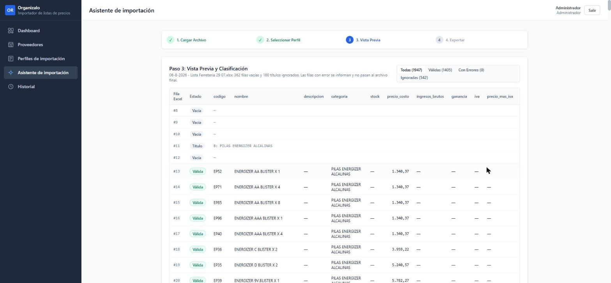
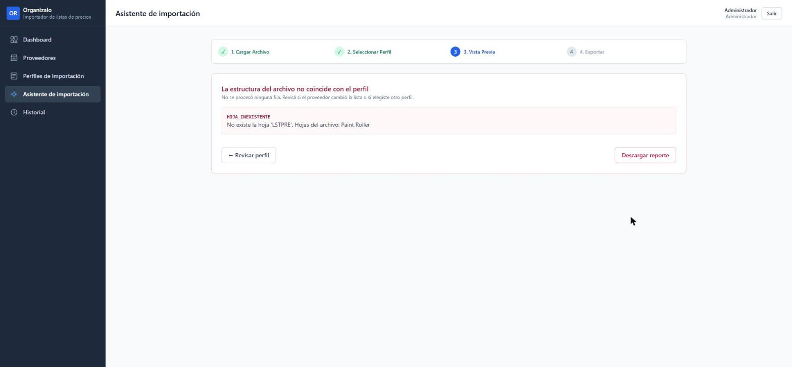

# Prueba del sistema desplegado

Recorrido de Organizalo en Railway (https://wonderful-vibrancy-production-e02e7fc2.up.railway.app) del 12/11/2026, con listas reales de Ferretería y Paint Roller que no se usaron para armar los perfiles. El objetivo es el que pidió el tutor el 29/09: reutilizar el perfil sobre listas nuevas del mismo proveedor y comprobar que el sistema detecta cuando un archivo no cumple el contrato.

## De dónde salen los archivos

Las listas son las que recibió el negocio y están en el repositorio, en [`dataset-example/dataset-versiones/`](../dataset-example/dataset-versiones/), con una subcarpeta por fecha de recepción. `VersionesListasTest` y `ParPaintRollerTest` las usan, así que los números de este documento se comprueban en cada `./mvnw test`.

```
dataset-example/dataset-versiones/
├── 06-8-2026/Lista Ferreteria 29 07.xlsx
├── 19-8-2026/Lista Ferreteria 19 08.xlsx
├── 08-9-2026/Lista Ferreteria 07 09.xlsx
├── 22-9-2026/Lista Ferreteria 21 09.xlsx
├── 06-10-2026/Lista Ferreteria 05 10.xlsx
├── 13-10-2026/Lista Ferreteria 05 10.xlsx            (misma lista, recibida de nuevo)
├── 26-10-2026/Lista Ferreteria 16 10.xlsx
├── 02-11-2026/Lista Ferreteria 02 11.xlsx
├── 05-9-2026/Lista de precios Mayorista - PAINT ROLLER.xlsx
├── 02-10-2026/Lista de precios Mayorista - PAINT ROLLER.xlsx
├── 02-10-2026/Lista_de_precios_Mayorista_-_PAINT_ROLLER_CORRECION.xlsx
├── 29-10-2026/Lista de precios Mayorista - PAINT ROLLER.xlsx
├── 02-11-2026/Lista de precios Mayorista - PAINT ROLLER.xlsx
├── 15-8-2026/Lista de precios Mayorista N°42 - PAINT ROLLERCORRECION - Con medidas.xlsx
└── 15-8-2026/Lista_de_precios_Mayorista_N_42_-_PAINT_ROLLER_CORRECION - Corregida por claude.xlsx
```

Para subirlas al sistema se copiaron a una carpeta temporal con el nombre `<subcarpeta> - <archivo>`, para que no se confundan las listas que tienen el mismo nombre. Por eso en el historial aparecen como `06-8-2026 - Lista Ferreteria 29 07.xlsx` o `02-11-2026 - Lista de precios Mayorista - PAINT ROLLER.xlsx`.

## Recorrido en el sistema desplegado

Usuario: `admin@tpi.local`, de `seed.sql`. El primer ingreso tardó unos 8 segundos ("Ingresando…"), porque los servicios tienen el modo Serverless de Railway y estaban suspendidos.

| # | Pantalla | Archivo subido | Captura |
| --- | --- | --- | --- |
| 1 | Dashboard sin importaciones | — | [01](capturas/01-dashboard-vacio.jpg) |
| 2 | Proveedores: los 5 del seed, activos, con un perfil cada uno | — | [02](capturas/02-proveedores.jpg) |
| 3 | Perfiles de importación | — | [03](capturas/03-perfiles.jpg) |
| 4 | Detalle del perfil de Ferretería: hoja LSTPRE, encabezados en la fila 7 (±3), mapeo y la regla `precio = COPIAR(precio_costo)` | — | [04](capturas/04-perfil-ferreteria.jpg) |
| 5 | Asistente, paso 1: cargar el Excel | — | [05](capturas/05-asistente-cargar.jpg) |
| 6 | Paso 2: proveedor Ferretería, perfil "Lista general", con el contrato que se va a aplicar | `06-8-2026/Lista Ferreteria 29 07.xlsx` | [06](capturas/06-asistente-perfil-ferreteria.jpg) |
| 7 | Paso 3: vista previa: 1947 filas, 1405 válidas, 0 errores | `06-8-2026/Lista Ferreteria 29 07.xlsx` | [07](capturas/07-preview-ferreteria-2907.jpg) |
| 8 | Paso 4: importación 1 confirmada, con las descargas | `06-8-2026/Lista Ferreteria 29 07.xlsx` | [08](capturas/08-importacion-confirmada.jpg) |
| 9 | Paso 2: proveedor Paint Roller, perfil "Lista mayorista" | `02-11-2026/Lista de precios Mayorista - PAINT ROLLER.xlsx` | [09](capturas/09-asistente-perfil-paintroller.jpg) |
| 10 | Vista previa: 159 válidas, 11 errores y los avisos de códigos repetidos. Se descartó (importación 2) | `02-11-2026/Lista de precios Mayorista - PAINT ROLLER.xlsx` | [10](capturas/10-preview-paintroller-0211.jpg) |
| 11 | Filtro "Con errores" de la misma lista | `02-11-2026/Lista de precios Mayorista - PAINT ROLLER.xlsx` | [11](capturas/11-errores-paintroller-0211.jpg) |
| 12 | Vista previa: 161 válidas, 9 errores. Se descartó (importación 3) | `29-10-2026/Lista de precios Mayorista - PAINT ROLLER.xlsx` | [12](capturas/12-preview-paintroller-2910.jpg) |
| 13 | Lista de Paint Roller procesada a propósito con el perfil de Ferretería: rechazada sin procesar filas (importación 4) | `02-11-2026/Lista de precios Mayorista - PAINT ROLLER.xlsx` | [13](capturas/13-rechazada-hoja-inexistente.jpg) |
| 14 | Historial: una confirmada, dos canceladas y una rechazada | — | [14](capturas/14-historial.jpg) |
| 15 | Dashboard con las importaciones recientes | — | [15](capturas/15-dashboard.jpg) |





## Reutilización del perfil con todas las versiones

Además del recorrido, `VersionesListasTest` corre el mismo motor (`ServicioImportacion.preview`, con los perfiles de `seed.sql`) sobre todas las versiones de la carpeta. Las tres que también se subieron al sistema desplegado dieron los mismos números en los dos lados.

### Ferretería, perfil "Lista general" (hoja LSTPRE)

| Lista | Archivo (en `dataset-versiones/`) | Estado | Válidas | Vacías | Títulos | Errores | Diferencias de estructura |
| --- | --- | --- | ---: | ---: | ---: | ---: | --- |
| 29/07 | `06-8-2026/Lista Ferreteria 29 07.xlsx` | Vista previa | 1405 | 362 | 180 | 0 | — |
| 19/08 (la del perfil) | `19-8-2026/Lista Ferreteria 19 08.xlsx` | Vista previa | 1412 | 361 | 180 | 0 | — |
| 07/09 | `08-9-2026/Lista Ferreteria 07 09.xlsx` | Vista previa | 1403 | 361 | 180 | 0 | Aviso: encabezados en la fila 8 en vez de la 7 |
| 21/09 | `22-9-2026/Lista Ferreteria 21 09.xlsx` | Vista previa | 1396 | 362 | 180 | 0 | Aviso: encabezados en la fila 8 en vez de la 7 |
| 05/10 | `06-10-2026/Lista Ferreteria 05 10.xlsx` y `13-10-2026/Lista Ferreteria 05 10.xlsx` | Vista previa | 1392 | 361 | 180 | 0 | — |
| 16/10 | `26-10-2026/Lista Ferreteria 16 10.xlsx` | Vista previa | 1394 | 361 | 180 | 0 | — |
| 02/11 | `02-11-2026/Lista Ferreteria 02 11.xlsx` | Vista previa | 1383 | 362 | 180 | 0 | — |

Las siete versiones, de julio a noviembre, se procesan con el mismo perfil y sin errores. El corrimiento de los encabezados a la fila 8 queda dentro del margen del perfil (±3) y se informa como aviso, sin bloquear la importación.

### Paint Roller, perfil "Lista mayorista"

| Lista | Archivo (en `dataset-versiones/`) | Estado | Válidas | Vacías | Títulos | Errores | Filas con error |
| --- | --- | --- | ---: | ---: | ---: | ---: | --- |
| 05/09 | `05-9-2026/Lista de precios Mayorista - PAINT ROLLER.xlsx` | Vista previa | 168 | 25 | 2 | 2 | 66, 81 |
| 02/10 (la del perfil) | `02-10-2026/Lista de precios Mayorista - PAINT ROLLER.xlsx` | Vista previa | 166 | 25 | 2 | 4 | 66, 81, 214, 215 |
| 02/10, corrección del negocio | `02-10-2026/Lista_de_precios_Mayorista_-_PAINT_ROLLER_CORRECION.xlsx` | Vista previa | 166 | 25 | 2 | 4 | 66, 81, 214, 215 |
| 29/10 | `29-10-2026/Lista de precios Mayorista - PAINT ROLLER.xlsx` | Vista previa | 161 | 25 | 2 | 9 | 66, 81 y 7 "SIN STOCK" |
| 02/11 | `02-11-2026/Lista de precios Mayorista - PAINT ROLLER.xlsx` | Vista previa | 159 | 25 | 2 | 11 | 66, 81 y 9 "SIN STOCK" |
| Corrección manual del 15/08 | `15-8-2026/Lista de precios Mayorista N°42 - PAINT ROLLERCORRECION - Con medidas.xlsx` | **Rechazada** | — | — | — | — | — |
| Otra copia de esa corrección | `15-8-2026/Lista_de_precios_Mayorista_N_42_-_PAINT_ROLLER_CORRECION - Corregida por claude.xlsx` | **Rechazada** | — | — | — | — | — |

Las correcciones del 15/08 son archivos que se rehicieron a mano, con otros encabezados (`NOMBRE`, `MEDIDAS`, `PRECIO`) y sin las columnas Bulto, Aclaración y Última actualización. El sistema las rechaza y lista las 6 diferencias. Es un caso real de lo que pidió el tutor: si el formato cambia, no se aplica el perfil en silencio.

Entre versiones se ve el cambio de precios. Por ejemplo, `RODLN1040000001` (rodillo cuero lanar 10 × 40) pasa de 4.475 el 29/10 a 4.654 el 02/11 (capturas 12 y 10).

## Hallazgos

1. **Paint Roller usa la columna "Codigo" para la marca en la sección ACCESORIOS.** RAPIFIX aparece entre 40 y 49 veces según la versión, FIJAPEL 5 veces, y además "Paint Roller", "Generico", "MOSTRADOR" y "DE PIE". El sistema lo informa como aviso, pero esas filas salen como válidas, así que el archivo para el sistema de gestión llevaría productos distintos con el mismo código. Hay que definir con el negocio qué código usar (por ejemplo, marca + medida) o rechazar esas filas.
2. **"SIN STOCK" en la columna de precio.** Pasa de 0 filas (05/09) a 9 (02/11). Hoy son errores con el motivo "no es un número". Es correcto que no pasen al archivo final, pero el negocio podría preferir que se marquen como "sin stock" y no como error.
3. **Filas 66 y 81 de Paint Roller:** tienen precio pero no código en todas las versiones. Son errores reales de la lista del proveedor y se informan bien.
4. **Ferretería y Paint Roller exportan `precio = costo`.** Es la regla provisoria de `seed.sql`. El negocio ya confirmó IIBB 4 %, ganancia 45 % e IVA 21 %, pero todavía no están cargados.
5. **Asistente, paso 2:** el proveedor arranca en el primero de la lista (Bulones), no en el que corresponde al archivo. Si el usuario no lo cambia, la importación sale rechazada por estructura, sin datos equivocados, pero es un paso de más.
6. **Primer ingreso lento** después de un rato sin uso, por el modo Serverless (ya está en las limitaciones del README y del informe).
